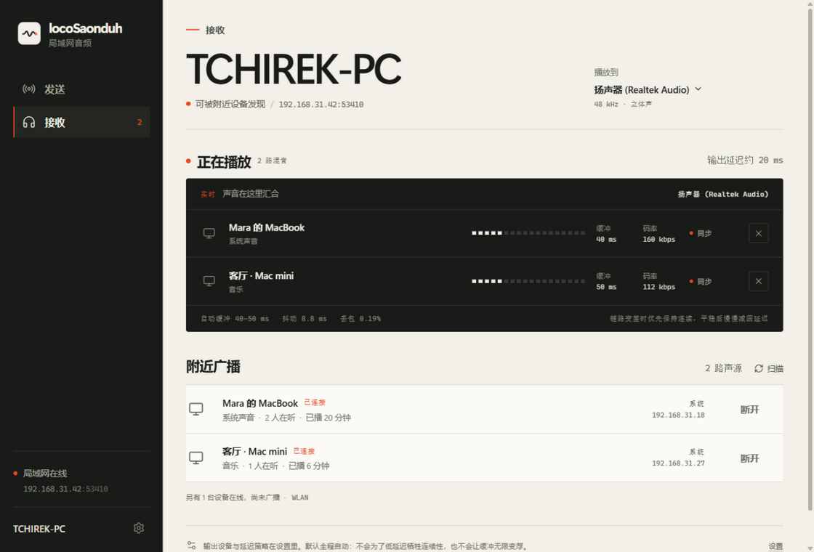
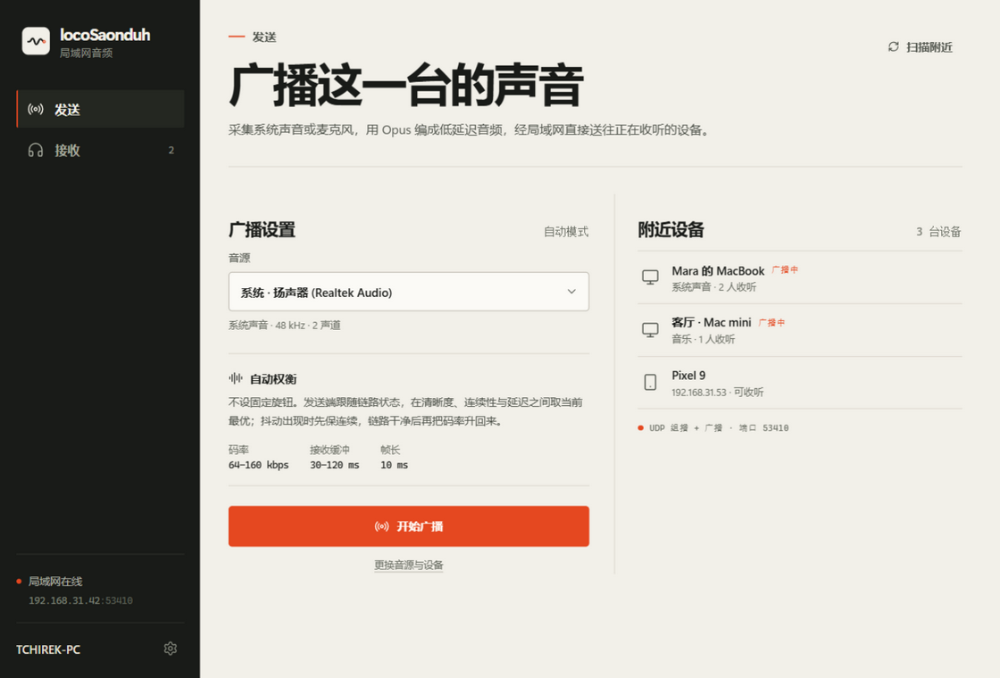
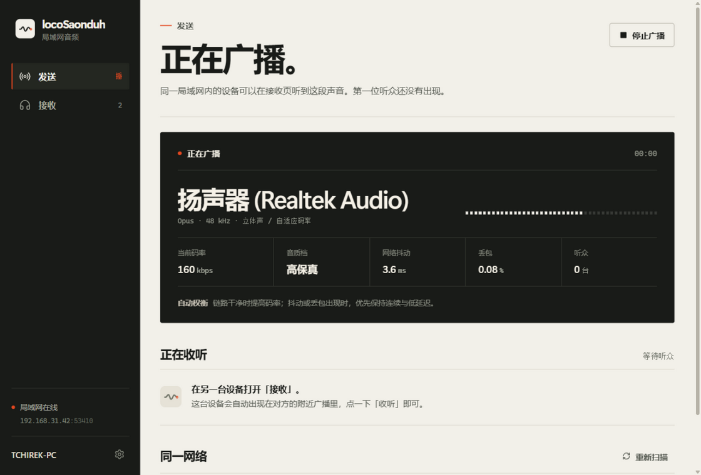

# 界面

界面借用 LocalSend 的骨架：发送 / 接收两个模式、对称的附近设备列表、不解释“登录”“房间”“配对”。音频工具不需要另一套概念。

视觉遵循 [kill-ai-slop](https://github.com/yetone/kill-ai-slop) 的核心约束：

- 纸、墨和一个信号红。没有渐变、玻璃、光晕和彩色阴影。
- 层级来自字号、字重与留白，而不是给字上色或塞满卡片。
- 细线分隔内容；圆角只到 4 px。
- 不使用 emoji。图标来自 Lucide，每个图标都承担真实操作或状态。
- 不使用蓝紫渐变、渐变标题、胶囊徽章墙、装饰性序号、编造的数据条。
- 动效只表达状态：180 ms 的进入、150 ms 的悬停、真实电平与旋转的扫描图标。遵循系统的 reduced-motion。
- 文案直接说这台设备会做什么，不写“革命性”“无缝体验”之类的宣传语。
- 字体使用平台原生多语言无衬线字体（Windows 上是 Segoe UI Variable / Microsoft YaHei UI）。不为拉丁文下载一个 Web Font，也不牺牲中文字重。
- 所有数字是真实指标：码率、抖动、丢包、缓冲、输出到设备的声音。

接收页的大标题是这台设备的名字本身，不是营销口号。深色控制台只在“正在广播 / 正在播放”时出现，用实际电平驱动刻度。没有订阅时，页面不假装有音频，而是给出如何加入的具体说明。

## 截图

截图来自内置的 UI 预览数据，设备名与网络地址是演示值；布局与交互和 Tauri 运行时一致。

### 接收，同时混音两路

### 发送，准备广播

### 发送，正在广播

